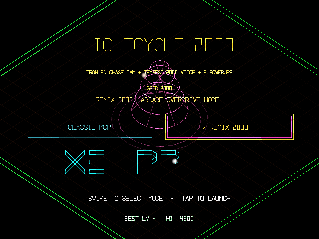
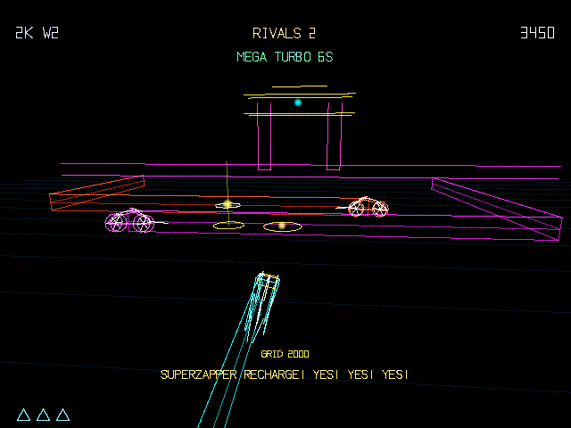

# X3 Cycles

X3 Cycles is a synthwave, isometric take on light-cycle combat for the RayNeo X3 Pro AR glasses, rendered in OpenGL ES as additive neon lines on pure black so the trails read as glowing light on the world through the glasses' waveguide display. You ride the grid at a constant speed, leaving a solid light wall behind you, and win by outlasting rivals who derez the instant they clip any wall — yours, theirs, or the arena border. Later levels add more rivals and, after enough waves, AI-controlled Recognizer tanks that hunt and fire on the player, while a hidden jump power-up lets a well-timed pickup save you from a wall you'd otherwise hit. Every sound in the game, from the engine drone to the derez shatter, is synthesized at runtime rather than sourced from audio files.

## Screenshots

  
  

## Game Modes (Selectable on Title Screen)

- **CLASSIC MCP Mode:** Original isometric orthographic view, constant-speed grid duels, Recognizer tanks, and Monopoly Control Protocol commentary.
- **REMIX 2000 Mode (LightCycle 2000 3D Arcade Overdrive):**
  - **3D Perspective Chase Camera** with banking 3/4 view behind a **3D Sculpted Light Cycle** (spinning hubless turbine wheels, aerodynamic canopy arch, dorsal Identity Disc, and twin plasma thrusters).
  - **140 BPM TB-303 Acid Rave Beat** synthesized at runtime + **Tempest 2000 Style Neural Human Voice Announcements** (*"Superzapper Recharge!"*, *"Yes! Yes! Yes!"*, *"Excellent!"*, *"Warp Bonus!"*, *"Identity Disc Overdrive!"*, *"Phase Shift Active!"*).
  - **6 Holographic 3D Power-Ups:** `SUPERZAPPER` (orbital lightning strike), `PHASE SHIFT` (ghost through walls), `MEGA TURBO`, `GRID PURGE` (dissolve rival walls), `DISC OVERDRIVE` (slice 3×3 breaches through walls & derez rivals), and `TIME DILATION`.
  - **Between-Wave 3D Octagonal Web Warp Tunnel** & **Towering Horizon Recognizer Gate** patrolling the north perimeter.

## Controls (RayNeo X3 Pro Temple Pad & DPAD)

- **Title Screen:**
  - **Swipe Forward / Back** (or `DPAD Left / Right`): Toggle between **CLASSIC MCP** and **REMIX 2000** mode
  - **Single Tap** (or `Enter / Space / DPAD Center`): Launch the selected mode
- **In-Race:**
  - **Swipe Forward / Back** (or `DPAD Left / Right`): Turn 90° right / left relative to your cycle's heading
  - **Single Tap** (in **REMIX 2000 Mode**): Fire an **Identity Disc** to breach walls ahead, or trigger a manual **Hyper Jump**
- **Game Over Screen:**
  - **Single Tap**: Retry current mode immediately
  - **Swipe Forward / Back**: Return to Title Screen to switch modes

## Download

[x3cycles.apk](x3cycles.apk)
